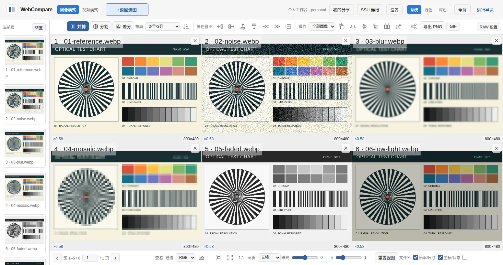
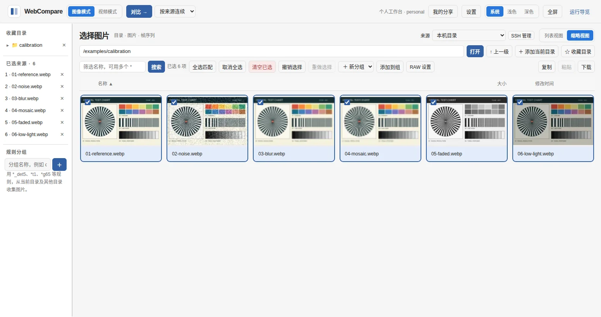
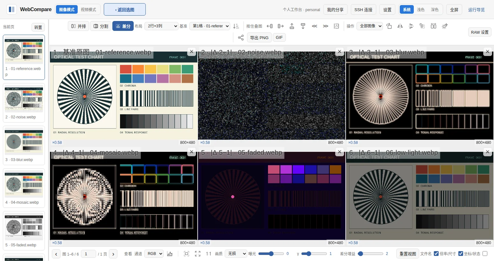
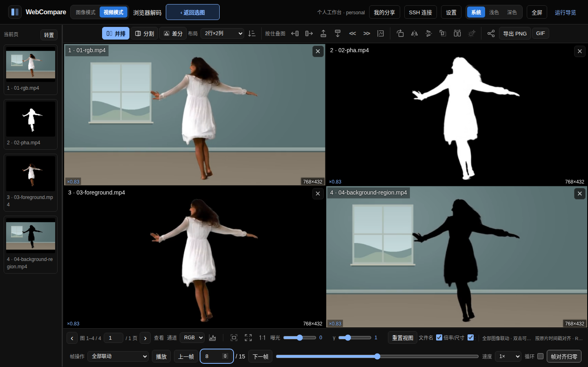

# WebCompare
【[简体中文](README.md) · **English**】 - 【[Run from source](#run-from-source) · [Download the Windows / Linux desktop app](https://github.com/fenghansen/WebCompare/releases)】 - 【[User guide (Wiki)](https://github.com/fenghansen/WebCompare/wiki/English)】

## Overview

I vibe-coded WebCompare for my own low-level vision research. The idea was to build something good enough to get on with the experiment. It probably has rough edges, and updates may take a while. I’m sharing it for teaching and reference. Thanks for bearing with me.

- **Web**　Run WebCompare on your GPU server and compare results in a browser on your own computer.
- **SSH**　Or run it locally and browse a remote experiment directory over SSH/SFTP.
- **Agent-friendly**　Give your favorite agent the results directory and tell it what you want to compare. It can use the CLI to pick the images, arrange them, and open the comparison for you.
- **Comparison**　Zoom in sync across results, overlay images from different directions, drag a split view, or inspect RGB differences. Export a PNG or GIF. Input formats include PNG, JPEG, static WebP, RAW and NPY.



## Image comparison

The workbench starts in Chinese. Open **设置 → 语言** and choose **English**. On desktop, open **Settings → Software updates** to check for a new release.

Start WebCompare and open `examples/calibration` in the file picker. Switch to thumbnails, select the six images in filename order, and open a **2 × 3** comparison.



Choose the first image as the difference reference and set the gain to **2**. Blur lights up the chart edges. The mosaic leaves steps along diagonal lines. The grayscale image changes only the colors, so the neutral gray patches stay black in its difference view.



## Video comparison

In the top-left corner of the workbench, switch to **Video mode**. Open `examples/video` and select the four MP4 files in filename order. Open a **2 × 2** comparison. The sample places a subject from VideoMatte240K in a simple room with a window and floor. The four tiles show the composited `RGB` clip, the alpha matte `α`, `RGB × α`, and `RGB × (1 − α)`. Each clip has 15 frames and runs for one second. 【[Sample sources and processing](examples/video/README.md)】

Press **Play** to view all four clips in sync. Pause to enter a frame number, step through frames or use the progress slider. Double-click a tile to step through that clip independently. Zoom, pixel inspection and difference views work on the current frame.



Personal uses available resources for images and video, including source-resolution media. Use a browser with WebCodecs over HTTPS or a loopback address. On a local NVIDIA system, the **Decoder** menu can enable NVDEC. Clips that fail to decode there fall back to the browser. [Video comparison guide](https://github.com/fenghansen/WebCompare/wiki/Comparison#compare-four-videos)

## Installation and launch

### Run from source

On Windows and Linux, one WebCompare service can serve several browser tabs. Open a tab for each experiment. With Git and Python 3.12 or later installed, clone the project:

```sh
git clone https://github.com/fenghansen/WebCompare.git
cd WebCompare
```

**Windows** — in PowerShell:

```powershell
.\install.bat
.\start.bat
```

**Linux** — in a terminal, without sudo:

```sh
./install.sh --no-desktop
./start.sh
```

Run the install script once to set up dependencies in the project’s `.venv`. After that, the start script opens the [workbench in your browser](http://127.0.0.1:7865).

**Using a remote server?** Run `./start.sh serve` there and leave the terminal open. On your own computer, start an SSH tunnel and visit the same address. The picker now reads directories on the server.

```sh
ssh -N -L 7865:127.0.0.1:7865 user@server
```

### Use a release package

Choose your platform on the [Releases page](https://github.com/fenghansen/WebCompare/releases).

- **Windows** — Download the portable x64 ZIP, extract the whole folder and open `WebCompare.exe`. Choose Setup if you want a Start menu shortcut.
- **Linux** — On a desktop with GTK3 and WebKitGTK 4.1, unpack the tar.gz and run `./webcompare-desktop`. You can also install the DEB with sudo. For browser-only use, install the release wheel in your Python environment and run `webcompare serve`.

## Command line

Desktop and Python installations share the `webcompare-ctl` interface. Pass images or result directories for a quick comparison. Use a JSON template to specify groups, layout and exposure.

```sh
webcompare-ctl compare results/reference results/method_a
webcompare-ctl template-example --output comparison.json
webcompare-ctl create-template comparison.json
```

## Sharing a server

Personal runs without a password by default. Binding to `--host 0.0.0.0` lets anyone who can reach that port access the workbench and read files available to the service account.

Server mode has local accounts for admins and members, plus temporary guest access. To start behind a reverse proxy:

```sh
export WEBCOMPARE_MODE=server
export WEBCOMPARE_BASE_URL=https://compare.example.org
export WEBCOMPARE_DATA_ROOT="$PWD/.runtime/server"
webcompare create-user admin --role admin
webcompare serve --host 127.0.0.1 --port 7865
```

## Thanks

Many of the layouts and features were inspired by [MegSpot](https://github.com/MegEngine/MegSpot). It’s a shame it’s no longer maintained. Here’s to those days when we poured our hearts into building things, and to a bright future for everyone.

LICENCE: [Apache License, Version 2.0](LICENSE)
