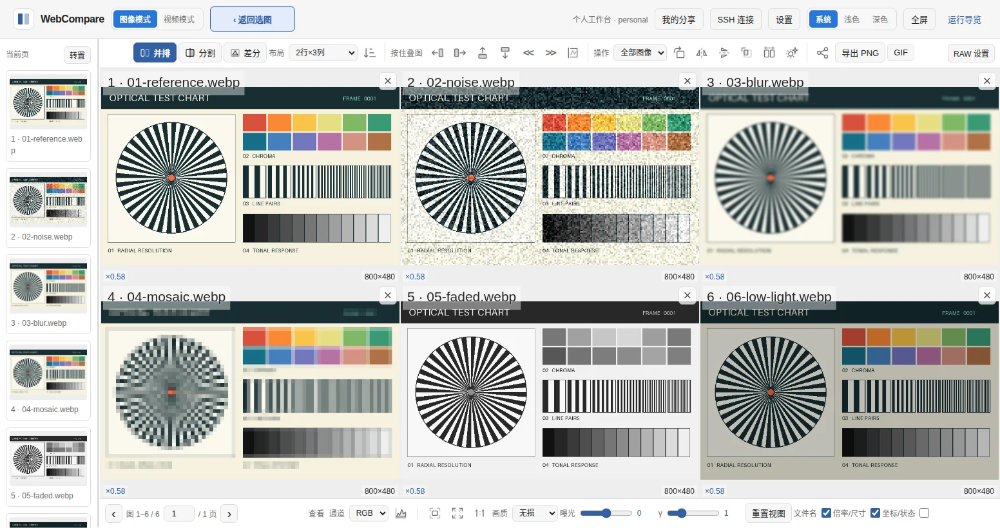
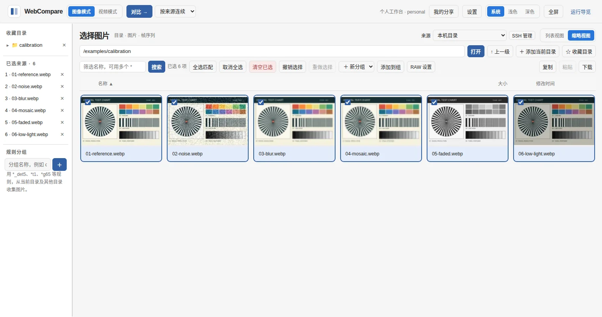
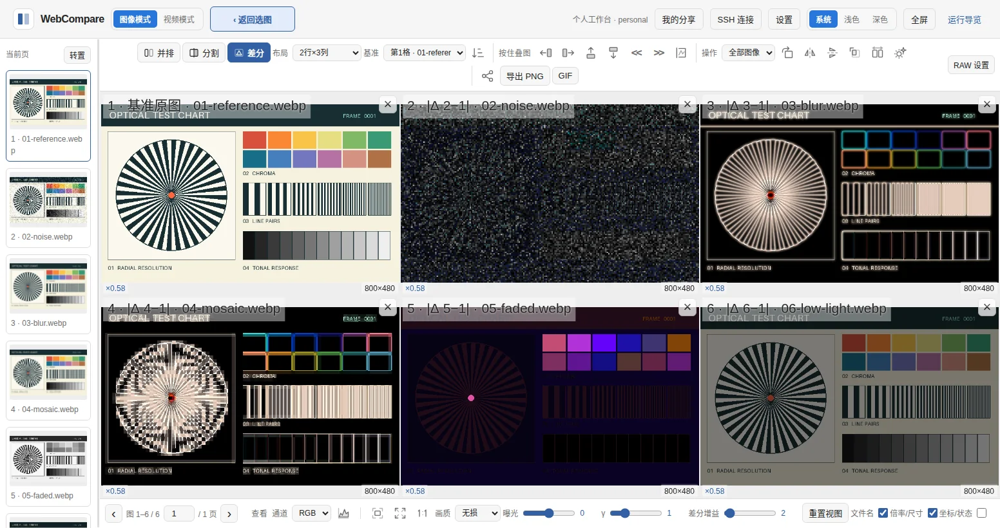
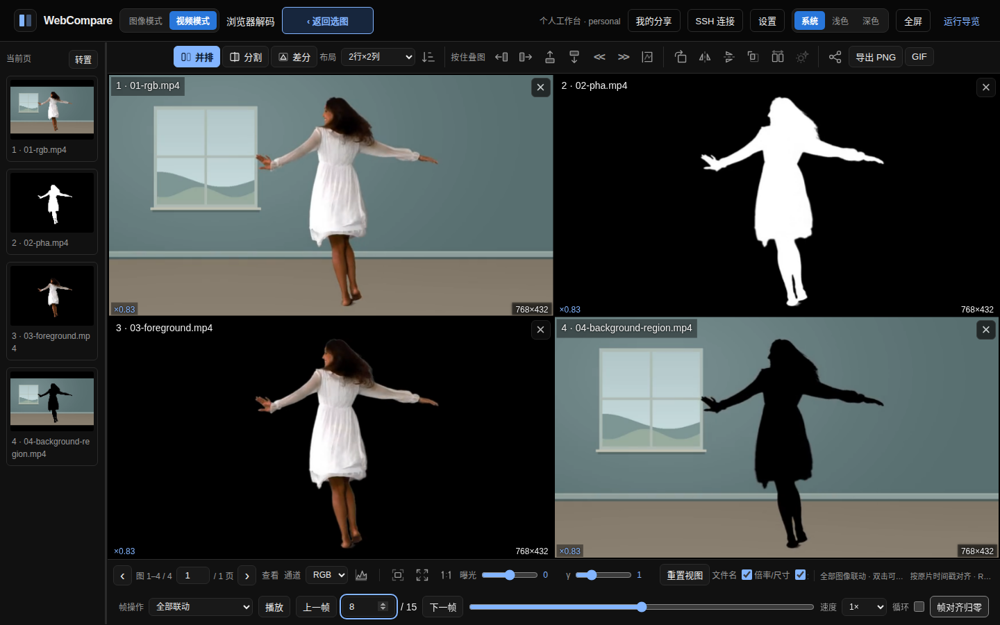

# WebCompare
【**简体中文** · [English](README.en.md)】 - 【[从源码启动](#从源码启动) · [下载 Windows / Linux 桌面程序](https://github.com/fenghansen/WebCompare/releases)】 - 【[使用手册 (Wiki)](https://github.com/fenghansen/WebCompare/wiki)】

## 简要说明

本项目为本人纯 vibe coding 开发的底层视觉科研辅助基建，主打一个“差不多就得了”，可能还有很多问题，不保证及时更新，仅供教学参考，万望海涵。

- **Web**：WebCompare 可以直接跑在 GPU 服务器上，本机打开浏览器就能比图。
- **SSH**：也可以在自己电脑上启动 WebCompare，通过 SSH/SFTP 打开远端实验目录，边选边看。
- **Agent 友好**：把结果目录交给你最爱的 Agent。你说想怎么比，它用 CLI 选图、分组、排版，直接打开比较。
- **比图**：多组结果同步缩放，各方向叠图、拖动分割线或看 RGB 差分，再把结果导成 PNG 或 GIF。支持 PNG、JPEG、静态 WebP、RAW 和 NPY。



## 图像比较

工作台默认使用中文，可在「设置 → 语言」切换 English。桌面版也可以在「设置 → 软件更新」检查新版。

启动 WebCompare 后，在选图页打开 `examples/calibration`，切到缩略视图，按名称顺序选中六张图。点击「对比」，布局选 **2 行 × 3 列**。



切到「差分」，基准选第 1 格，增益设为 **2**。左上角保留参考图。模糊让边缘发亮，马赛克留下阶梯。灰度版只去色，原本的中性灰在差分图里仍是黑色。



## 视频比较

在工作台左上角切换「视频模式」，打开 `examples/video`，按文件名顺序选中四个 MP4，打开 **2 行 × 2 列**。样片把 VideoMatte240K 的人物合成到带窗格和地板的简洁布景。四格依次显示合成画面 `RGB`、透明度 `α`、`RGB × α` 和 `RGB × (1 − α)`，每路 15 帧、1 秒。 [【素材出处与处理方法说明】](examples/video/README.md)

点击「播放」同步查看四路。暂停后用帧号、前后帧或进度条定位，也可以双击一格后单独步进，检查该路的时序。缩放、取色和差分使用当前帧。



Personal 的图片和视频按实际资源处理，可直接打开原始分辨率素材。浏览器需支持 WebCodecs；用 HTTPS 或环回地址访问。本机 NVIDIA 设备可在「解码」中按提示启用 NVDEC，个别解码失败的素材会回到浏览器路径。 [视频操作手册](https://github.com/fenghansen/WebCompare/wiki/Comparison-zh#比较四路视频)

## 安装与运行

### 从源码启动

Windows 和 Linux 都可以直接用浏览器比图。同一个服务可以开多个标签页，每组实验一个页面。准备好 Git 和 Python 3.12 或更高版本，先下载源码：

```sh
git clone https://github.com/fenghansen/WebCompare.git
cd WebCompare
```

**Windows** 在 PowerShell 里运行：

```powershell
.\install.bat
.\start.bat
```

**Linux** 在终端运行，无需 sudo：

```sh
./install.sh --no-desktop
./start.sh
```

`install` 只需运行一次，会在项目的 `.venv` 里安装依赖。之后用 `start` 启动，本机会打开 [浏览器工作台](http://127.0.0.1:7865)。

**在远程服务器上看图**时，在服务器运行 `./start.sh serve`，保持终端运行。在自己的电脑上建立 SSH 隧道，然后打开同一个浏览器地址。选图时填服务器上的目录。

```sh
ssh -N -L 7865:127.0.0.1:7865 user@server
```

### 使用发布包

从 [Releases](https://github.com/fenghansen/WebCompare/releases) 选择对应平台：

- **Windows** 推荐 x64 便携 ZIP。解压整个目录，双击 `WebCompare.exe`。需要开始菜单入口时选 Setup。
- **Linux** 图形桌面已有 GTK3 和 WebKitGTK 4.1 时，解压 tar.gz 并运行 `./webcompare-desktop`。有 sudo 权限也可安装 DEB。只想运行浏览器工作台时，可在自己的 Python 环境安装同版 wheel，再运行 `webcompare serve`。

## 命令行

桌面版和 Python 版共用 `webcompare-ctl`。传入文件或结果目录即可打开比较；JSON 模板还可以指定分组、布局和曝光。

```sh
webcompare-ctl compare results/reference results/method_a
webcompare-ctl template-example --output comparison.json
webcompare-ctl create-template comparison.json
```

## 多人访问

Personal 默认免密码。使用 `--host 0.0.0.0` 时，任何能连接端口的人都能访问工作台并读取服务账号可读的文件。

多人 Server 使用本地账号，支持管理员、成员和临时访客。在反向代理后启动：

```sh
export WEBCOMPARE_MODE=server
export WEBCOMPARE_BASE_URL=https://compare.example.org
export WEBCOMPARE_DATA_ROOT="$PWD/.runtime/server"
webcompare create-user admin --role admin
webcompare serve --host 127.0.0.1 --port 7865
```

## 致谢

很多布局和功能的灵感来自 [MegSpot](https://github.com/MegEngine/MegSpot)，可惜没人维护了……敬那段激情燃烧的岁月，愿大家都有美好的未来。

LICENCE：[Apache License, Version 2.0](LICENSE)
